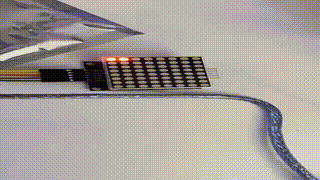

# Arduino 8x8 LED Matrix Display

An Arduino LED-matrix project that progressed from basic row tests and bitmap graphics to a final scrolling display for the letters **T-R-O-Y** on an **8x8 MAX7219 LED matrix**.



**[Watch the hardware demo](media/led-matrix-demo.mp4)**

## Final implementation

The final sketch defines each letter as an 8-byte bitmap. `scrollLetter()` shifts the bitmap across the display one step at a time and writes each row through the `LedControl` library.

```text
T -> R -> O -> Y -> repeat
```

The final recovered version uses an intensity value of 5, a 200 ms shift delay, and a short pause between letters.

## Hardware

- Arduino-compatible board
- 8x8 LED matrix with MAX7219-compatible controller
- Jumper wires / breadboard

Final-sketch pin mapping:

| Signal | Pin |
|---|---:|
| DIN | 51 |
| CLK | 52 |
| CS | 53 |

The final sketch therefore matches Arduino Mega-style pin numbering. Earlier experiments in this repository used a different 10/11/12 pin mapping while the project was being developed.

## Project progression

The `experiments/` directory preserves useful earlier iterations:

- `Led_OneLine.ino` - row-pattern testing
- `Led_Smiley.ino` - custom 8x8 bitmap graphic
- `Name_Static.ino` - static T/R/O/Y letter display
- `Name_Scroll_Earlier.ino` - earlier scrolling implementation

The final version is `src/Name_Scroll_New.ino`.

## Repository layout

```text
.
├── README.md
├── src/
│   └── Name_Scroll_New.ino
├── experiments/
│   ├── Led_OneLine.ino
│   ├── Led_Smiley.ino
│   ├── Name_Static.ino
│   └── Name_Scroll_Earlier.ino
└── media/
    ├── preview.gif
    └── led-matrix-demo.mp4
```

## Build and run

1. Install the **LedControl** library in Arduino IDE.
2. Wire the MAX7219 matrix to the pins in the table above.
3. Open `src/Name_Scroll_New.ino`.
4. Select the matching Arduino board and serial port.
5. Compile and upload.

## Skills demonstrated

Arduino C/C++, bitmapped graphics, bit shifting, MAX7219 LED-matrix control, display timing, iterative prototyping, and hardware debugging.
